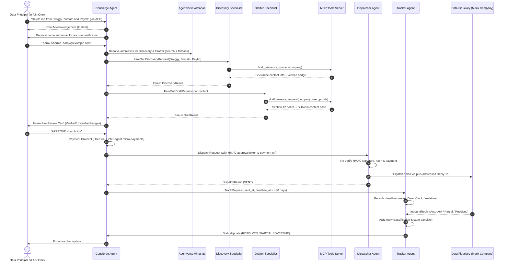

# DeleteMe: Autonomous DPDPA 2023 Rights Agent


[](https://www.python.org/downloads/release/python-3120/)
[](tests/)
[](https://fetch.ai/)
[](https://asi1.ai/)

> **Autonomous multi-agent decentralized privacy infrastructure empowering 1.4 billion Indian citizens to reclaim their digital sovereignty under the Digital Personal Data Protection Act, 2023 (DPDPA).** Built on Fetch.ai uAgents, ASI:One, and the Model Context Protocol (MCP).

---

## 1. Executive Summary

### The Problem
Indian consumers register with dozens of digital services—e-commerce, food delivery, ride-hailing, fintech, and quick-commerce platforms. Long after an app is uninstalled, user personal data (transaction ledgers, geolocation history, phone numbers, KYC tokens, and behavioural logs) persists across corporate servers and secondary data processors.

Under **Section 12 of India's Digital Personal Data Protection Act, 2023 (DPDPA)**, every citizen holds the statutory Right to Erasure. However, in practice:
- Finding designated Grievance Officers under **DPDP Rule 9** requires digging through obscure legal terms.
- Drafting legally compliant notices citing statutory exceptions is complex.
- Verifying delivery, enforcing cryptographic approval gates, and tracking 30-day statutory response deadlines across multiple fiduciaries creates an impossible administrative burden for consumers.

### The Solution: DeleteMe Agent
**DeleteMe** is an autonomous multi-agent system accessible entirely within a single conversation turn in **ASI:One**. It:
1. Understands natural language requests in English and Hinglish via the **Agent Chat Protocol (ACP)**.
2. Performs dynamic fan-out across specialist agents to discover verified Grievance Officers using **Model Context Protocol (MCP)** tools.
3. Compiles statutory Section 12 erasure notices with pre-commencement "good-faith" wording.
4. Enforces a human-in-the-loop cryptographic gate with **HMAC-SHA256 tokens** and **Interactive Cards**.
5. Manages native Fetch.ai **Payment Protocol** fees and inter-agent micropayments.
6. Operates an autonomous, long-running **Tracker Agent** that sweeps 30-day deadlines, classifies inbound corporate replies (e.g. tax exemptions under Section 44AA of the Income Tax Act), sends follow-ups, and drafts formal grievance complaints for the **Data Protection Board of India** under Section 13(3).

---

## 2. Multi-Agent Architecture



---

## 3. Registered Agent Registry

All 6 agents utilize deterministic seed phrases yielding permanent Fetch.ai network addresses:

| Agent Name | Role | Deterministic Address | Profile Document | Network Status |
|---|---|---|---|---|
| **`deleteme_concierge`** | Conversational ACP & Orchestrator | `agent1qfq66d3thuzjl620d06sqn88j0ey650up6ltwt46qhljraz2fe4g50yap2z` | [`agents/concierge/README.md`](file:///d:/FetchAThon/agents/concierge/README.md) | Online / ACP Enabled |
| **`deleteme_discovery`** | Rule 9 Contact Discovery | `agent1qtsk8vqfdywqg89mswxg29dpeftnnxq6jvmp0yphv9z5vcl67fgrjdsdnqg` | [`agents/discovery/README.md`](file:///d:/FetchAThon/agents/discovery/README.md) | Online / MCP Enabled |
| **`deleteme_drafter`** | Section 12 Legal Notice Drafting | `agent1q0su27nruzqk75kpwdtese6k083lde3lzj2aw5yawfw00y9d9u6kcffus6l` | [`agents/drafter/README.md`](file:///d:/FetchAThon/agents/drafter/README.md) | Online / PII Guarded |
| **`deleteme_dispatcher`** | Secure Outbound SMTP Dispatcher | `agent1qwmqhv5ll2fswhhvfxtzywfsxew2a3ufln2tsj8vzkzdktd789tpw7cmmup` | [`agents/dispatcher/README.md`](file:///d:/FetchAThon/agents/dispatcher/README.md) | Internal (No public ACP) |
| **`deleteme_tracker`** | Long-Running Deadline Auditor | `agent1qfs4f9apm6hg066577z8t2my673s9d0gcx2jjafeatujvpcpgr2ag9swpsd` | [`agents/tracker/README.md`](file:///d:/FetchAThon/agents/tracker/README.md) | Online / ACP Enabled |
| **`deleteme_mock_company`** | Simulated Indian Data Fiduciary | `agent1qwhk3gqawq5auzsddt44mt77wrr8078yvzexp9l35cq22vymfus3qex5je4` | [`agents/mock_company/README.md`](file:///d:/FetchAThon/agents/mock_company/README.md) | Simulated Testbed |

---

## 4. Fetch.ai Technology Evidence Table

| Judging Criterion | Fetch.ai Technology | Implementation Code Location | How to Verify in Demo / Judging |
|---|---|---|---|
| **Agentverse Registration** | 6 registered agents with profiles & badges | [`agents/*/README.md`](file:///d:/FetchAThon/agents/) | Inspect Agentverse profile URLs with `innovationlab` and `hackathon` badges. |
| **Agent Chat Protocol (ACP)** | Native ACP chat protocol (`publish_manifest=True`) | [`shared/acp.py`](file:///d:/FetchAThon/shared/acp.py) | Interactive conversation in ASI:One with instant acknowledgments. |
| **ASI1 Reasoning** | Structured LLM extraction, classification & drafting | [`shared/asi1_client.py`](file:///d:/FetchAThon/shared/asi1_client.py) | Run `DEBUG` to see ASI1 prompt purposes, model calls, and latencies. |
| **Multi-Agent Orchestration** | Parallel fan-out/fan-in with typed uAgents models | [`agents/concierge/orchestrator.py`](file:///d:/FetchAThon/agents/concierge/orchestrator.py) | Run `DEBUG` to see fan-out discovery and drafting durations. |
| **Dynamic Discovery** | Agentverse Almanac search with local env fallback | [`agents/concierge/registry.py`](file:///d:/FetchAThon/agents/concierge/registry.py) | In `DEBUG` trace: `[REGISTRY] discovery via agentverse_search/env_fallback`. |
| **Interactive Cards** | Rich Confirmation, Review, Status & Reply Cards | [`agents/concierge/cards.py`](file:///d:/FetchAThon/agents/concierge/cards.py) | Actionable card buttons for `APPROVE`, `YES`, and `STATUS`. |
| **Payment Protocol** | User service fee + inter-agent micro-payments | [`shared/payments.py`](file:///d:/FetchAThon/shared/payments.py) | Trace log displays FET transfers between Concierge, Discovery, and Tracker. |
| **Model Context Protocol (MCP)** | FastMCP tools: `find_grievance_contact` & `draft_erasure_request` | [`mcp/server.py`](file:///d:/FetchAThon/mcp/server.py), [`mcp/tools.py`](file:///d:/FetchAThon/mcp/tools.py) | `[MCP] Tool: draft_erasure_request` telemetry logged in `DEBUG`. |
| **Long-Running Agent** | Periodic statutory deadline sweeps (`on_interval`) | [`agents/tracker/agent.py`](file:///d:/FetchAThon/agents/tracker/agent.py) | Paytm 30-day deadline expiration, follow-up, and Section 13(3) escalation draft. |

---

## 5. Monetization Model

DeleteMe introduces a sustainable, transparent business model natively aligned with Fetch.ai testnet/mainnet micro-economics:

1. **User Batch Fee (Consumer → Concierge)**:
   - Fixed fee of **0.001 FET** (1,000,000,000,000,000 atestfet) charged upon approving a multi-company deletion batch.
   - Replaces predatory $120/year Western SaaS subscriptions with pay-per-use micropayments affordable to Indian consumers.
   - *Demo Note:* Automatically labelled with `💡 [Demo Mode: Testnet payment auto-bypassed]` for judging evaluation when `PAYMENTS_BYPASS_FOR_DEMO=true`.
2. **Specialist Inter-Agent Micro-Payments (Concierge → Specialist Agents)**:
   - **Discovery Lookup Fee**: **0.0001 FET** paid to the Discovery Agent per company policy parsed.
   - **Tracking Fee**: **0.0002 FET** paid to the Tracker Agent per request monitored for 30 days.
   - Incentivizes independent node runners to deploy specialized privacy crawlers and monitoring daemons on Agentverse.
3. **Future Enterprise / Consumer Subscription**:
   - Continuous monitoring (auto-erasing personal data whenever an account goes inactive for 6 months).

---

## 6. Installation & Quickstart

### Prerequisites
- Python 3.11 or 3.12 (Python 3.12 recommended)
- `uv` (recommended) or standard `pip`
- Git

### 1. Clone & Set Up Environment
```bash
git clone https://github.com/your-username/deleteme-agent.git
cd deleteme-agent

# Create virtual environment
python -m venv .venv
source .venv/bin/activate  # On Windows: .venv\Scripts\activate

# Install dependencies
pip install -e .
```

### 2. Configure Environment Variables
Copy `.env.example` to `.env`:
```bash
cp .env.example .env
```
Key configuration settings:
```ini
# Send Mode: dry_run (tests) | demo_redirect (demo video) | live (production)
SEND_MODE=demo_redirect
DEMO_RECIPIENT_OVERRIDE=demo-inbox@example.com

# Demo Clock Speed: 1.0 (real-time) or 86400.0 (1 real second = 1 day)
DEMO_CLOCK_SPEED=86400.0

# Payment Bypass for Demo
PAYMENTS_BYPASS_FOR_DEMO=true

# ASI1 API Key (defaults to mock-asi1-key with deterministic FakeASI1)
ASI1_API_KEY=mock-asi1-key
USE_FAKE_ASI1=true
```

---

## 7. Running Tests & Automated Demo

### Run Full Test Suite (62 Tests Passing Offline)
```bash
# On Linux/macOS:
make test

# On Windows PowerShell:
.\make.ps1 test
```

### Run the Full Scenario Demo in ~5 Seconds
Demonstrates the complete Swiggy, Zomato, and Paytm workflow end-to-end with simulated clock acceleration:
```bash
# On Linux/macOS:
bash scripts/demo.sh

# On Windows PowerShell:
.\scripts\demo.ps1
```

---

## 8. Simulated Components Disclosure

In accordance with hackathon guidelines, the following subsystems run in documented simulation mode for demonstration safety:
1. **`agents/mock_company/agent.py`**: Simulates responses from Indian corporate servers (Swiggy confirming erasure, Zomato asserting 7-year tax retention, Paytm remaining silent to demonstrate escalation).
2. **`SEND_MODE=demo_redirect`**: Redirects all outgoing emails to `demo-inbox@example.com` with explicit simulation headers to avoid spamming real Grievance Officers during judging.
3. **`DemoClock`**: Accelerates statutory 30-day deadlines (`DEMO_CLOCK_SPEED=86400`) so judges can observe long-running behaviors within seconds.

---

## 9. Legal Disclaimer

> **Notice:** DeleteMe Agent provides automated informational tools and machine-generated templates under the Digital Personal Data Protection Act, 2023. **This service does not provide formal legal advice and does not constitute a legal practice.** Data Principals should review all drafted communications before submission to regulatory authorities or courts.
