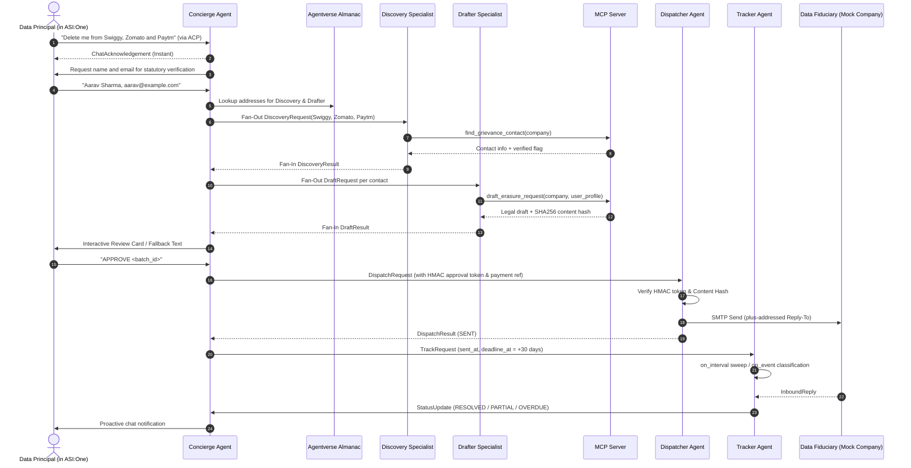

# DeleteMe Architecture Specification

The **DeleteMe DPDPA Rights Agent** is an autonomous multi-agent decentralized privacy infrastructure engineered on **Fetch.ai uAgents**, **ASI:One**, and the **Model Context Protocol (MCP)**.

---

## 1. System Multi-Agent Flow



---

## 2. External MCP Client Integration Guide

The DeleteMe system provides a standalone **Model Context Protocol (MCP)** server at `mcp/server.py` that can be queried by external AI assistants like **Claude Desktop**, **Cursor**, or custom MCP clients.

### Available MCP Tools
1. **`find_grievance_contact`**:
   - Argument: `company` (string, e.g. `"Swiggy"`)
   - Output: Grievance Officer name, email, verified status, source policy URL.
2. **`draft_erasure_request`**:
   - Arguments: `company` (string), `user_profile` (object with `name`, `email`, `phone`, `identifiers`)
   - Output: Legally formatted DPDPA Section 12 erasure request, verified status, and SHA-256 hash.

### Configuring Claude Desktop (`claude_desktop_config.json`)
```json
{
  "mcpServers": {
    "deleteme-dpdpa": {
      "command": "python",
      "args": ["-m", "mcp.server"],
      "cwd": "D:\\FetchAThon"
    }
  }
}
```

### Configuring Cursor (`.cursor/mcp.json`)
```json
{
  "mcpServers": {
    "deleteme-dpdpa": {
      "command": "python",
      "args": ["-m", "mcp.server"],
      "cwd": "${workspaceFolder}"
    }
  }
}
```

---

## 3. Cryptographic Invariants & Security Gating
1. **HMAC-SHA256 Token**:
   - `content_hash = sha256(canonical_json(drafts))`
   - `token = HMAC(APPROVAL_HMAC_SECRET, batch_id + session_id + content_hash)`
   - Any manual `EDIT` or `REMOVE` modifies the content hash, instantly invalidating previous approval tokens.
2. **Prohibited PII Defense**:
   - The Drafter agent and MCP tools reject any draft containing 12-digit Aadhaar numbers, PAN numbers, OTPs, or passwords with an immediate `ValueError`.
